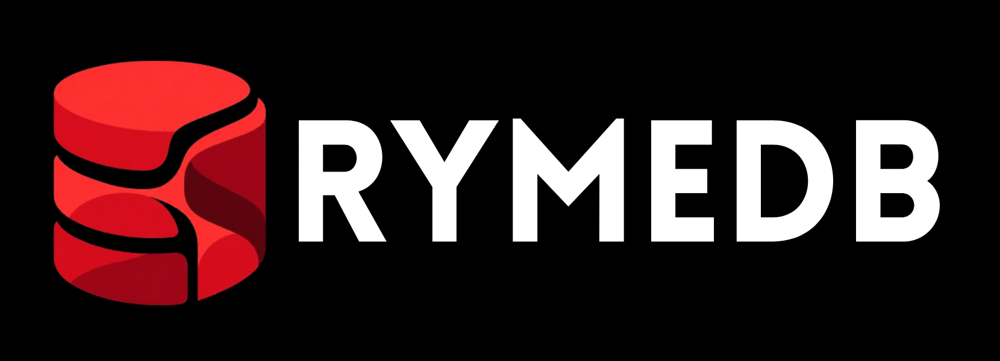

# rymeDB

rymeDB is an open-source, Rust-first distributed relational database for transactional and realtime applications.
One server exposes PostgreSQL-compatible wire, RESP, REST, GraphQL, and WebSocket interfaces.
Its storage core combines MVCC transactions and WAL with hot-memory or immutable-segment persistence.
Raft replication, tenant-aware authorization, branching, and backup features support reliable application data.
Realtime change streams connect committed database updates to clients.

[Documentation](https://db.rymelabs.dev/) · [Installation and setup](https://db.rymelabs.dev/setup/) · [REST API reference](https://db.rymelabs.dev/api/)
