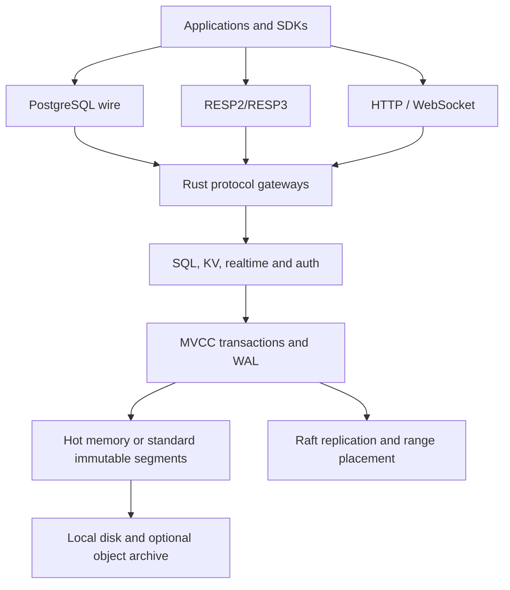

rymeDB is a Rust-first database and backend server for realtime applications.
One `ryme-server` process exposes relational SQL, a PostgreSQL-compatible wire
endpoint, RESP2/RESP3, REST, GraphQL, WebSockets, optional native/gRPC
listeners, authentication, branching, backups, and cluster administration.

:::warning[Project status]

This repository is an active early-stage project. Compatibility is broad but
not identical to PostgreSQL, Redis/Valkey, or Supabase. Test your migrations
and workload before using it for production data. The benchmark page reports
measured results and does not claim a universal “10000x” speedup.
:::

## Start in five minutes

### From source

```bash
export RYME_API_KEY=local-dev-key
cargo run --locked -p ryme-server -- --http-listen 127.0.0.1:8080 --pg-listen 127.0.0.1:5433 --resp-listen 127.0.0.1:6380 --data-dir ./data
```

The server CLI has flags, not a `serve` subcommand. The command above is the
canonical local setup. It keeps all listeners on loopback and persists data in
`./data`.

### With Docker

```bash
docker pull ghcr.io/ryme-labs/rymedb:latest
docker run --name rymeDB --rm \
  -e RYME_API_KEY=local-dev-key \
  -p 5433:5433 -p 6380:6380 -p 8080:8080 \
  -v rymeDB-data:/var/lib/rymedb \
  ghcr.io/ryme-labs/rymedb:latest \
  --pg-listen 0.0.0.0:5433 --resp-listen 0.0.0.0:6380 --http-listen 0.0.0.0:8080
```

Then verify it:

```bash
curl -fsS -H 'Authorization: Bearer local-dev-key' http://127.0.0.1:8080/ready
psql 'postgresql://postgres@127.0.0.1:5433/postgres' -c 'SELECT 1;'
redis-cli -p 6380 PING
```

See [setup](setup.md) for prerequisites, images, volumes, and a complete
smoke test.

## What is implemented

| Area | Available now |
| --- | --- |
| Storage | MVCC transactions, WAL, hot/standard storage modes, immutable segments, compaction, TTLs |
| SQL | DDL, DML, joins, aggregates, CTEs, views, sequences, constraints, indexes, COPY, RLS metadata, functions/triggers metadata |
| PostgreSQL | Simple and extended query protocol, prepared statements, savepoints, COPY, notifications, cancellation, common driver session queries |
| RESP | RESP2/RESP3, strings, hashes, lists, sets, sorted sets, streams, consumer groups, scripting, transactions, pub/sub, geospatial, HyperLogLog |
| Realtime | CDC streams, reactive query streams, broadcast, presence, durable topics, Supabase Realtime channel frames |
| Distributed | Raft membership, quorum replication, range placement, split/merge/transfer, learners, leadership transfer, TLS mesh |
| Branches | Copy-on-write branch schemas and rows, reset, promote, diff, branch-scoped migrations |
| Recovery | Checkpoints, snapshots, PITR, local/S3 archives, replica copies, encrypted archive verification drills |
| Backend APIs | REST CRUD, SQL, GraphQL, key/value, vector search, text search, health/metrics/observability |
| Security | API keys, password auth, JWT/JWKS, OIDC helpers, OTP, passkeys, TLS/mTLS, tenant scoping, RLS |
| Clients | npm/TypeScript and Rust SDKs; raw HTTP/WebSocket, PostgreSQL, RESP, and CLI access |

The standalone <a href="https://db.rymelabs.dev/api/">REST/OpenAPI reference</a> is generated from
the checked-in `schemas/openapi/rest.yaml` and served through Swagger UI. The
source code and tests remain the final authority when documentation and
implementation disagree.

## Pick a path

| You are… | Read… |
| --- | --- |
| Setting up rymeDB | [Setup rymeDB](setup.md) |
| Connecting an existing app | [PostgreSQL](postgres.md), [RESP](resp.md), or an [SDK guide](sdk-js.md) |
| Building chat, games, or agents | [Realtime](streaming.md), [auth and tenants](auth.md), and [operations](production.md) |
| Moving data from PostgreSQL, Supabase, Neon, or Redis | [Migration guide](migration.md) |
| Operating a node or cluster | [Configuration](configuration.md), [cluster operations](cluster-operations.md), and [backup/restore](backup-restore.md) |
| Investigating latency | [Measured performance](performance.md) and [troubleshooting](troubleshooting.md) |
| Contributing | [Development](development.md), [security](security.md), and [SDK releases](sdk-release.md) |

## Design at a glance



Keep the [performance page](performance.md) beside any throughput claim. A
durable serializable transaction, a cache `GET`, and a WebSocket delivery are
different workloads and must not be collapsed into one number.
