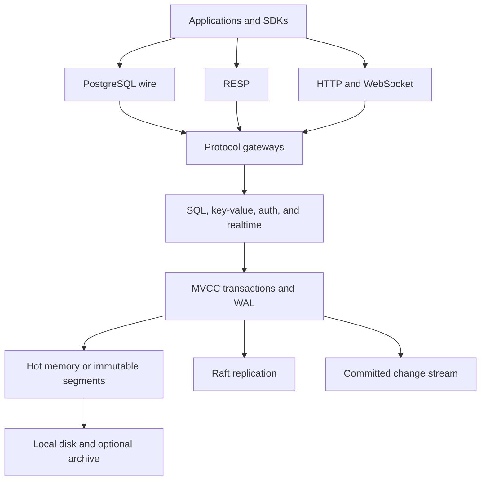

# rymeDB

rymeDB is a Rust-first distributed relational database for transactional and realtime applications. PostgreSQL-compatible, RESP, REST, GraphQL, and WebSocket gateways share one database and transaction layer.

## Architecture

Protocol gateways route requests into SQL, key-value, and realtime operations. MVCC transactions and the write-ahead log provide the shared consistency boundary. Storage can keep data in hot memory or persist it in immutable segments; Raft replicates committed state across nodes. Committed changes also feed realtime streams, while optional archives support recovery.

<a href="/setup/">Installation and setup</a> · <a href="https://db.rymelabs.dev/api/">REST API reference</a>
